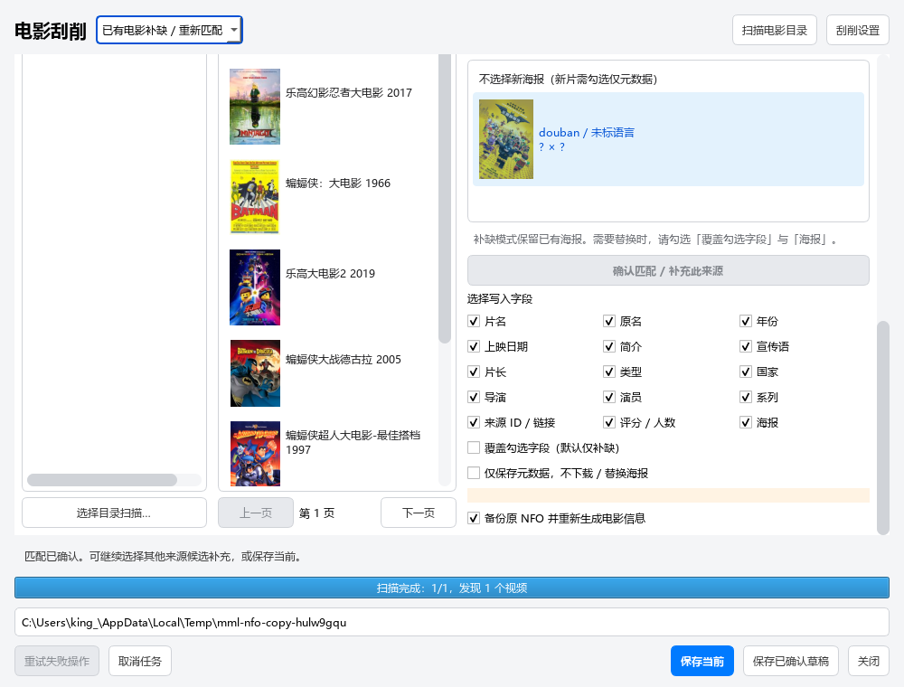
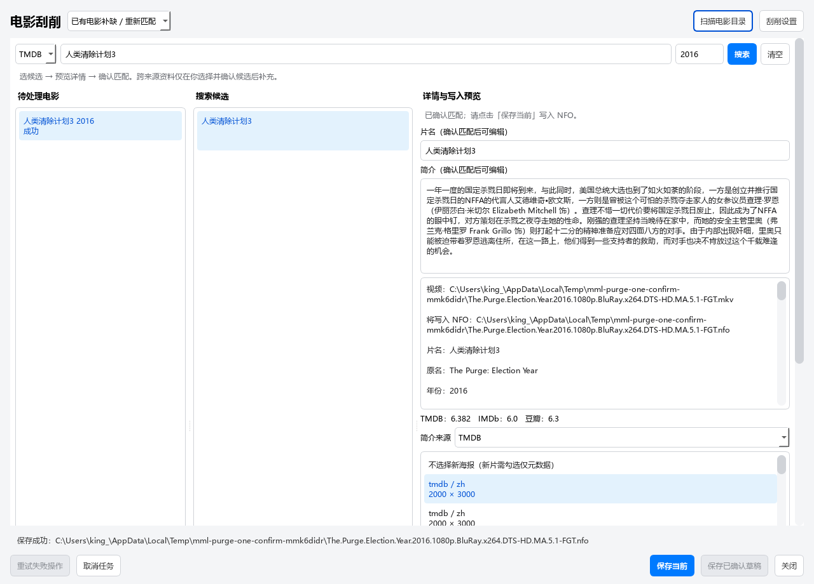

# 桌面内置电影刮削

电影墙现在直接发现新视频、搜索和人工匹配电影、选海报、获取简介及评分并生成 NFO，不再要求先运行 tinyMediaManager。功能仅在桌面版开放，网页版保留原有豆瓣补分接口。

## 入口与模式

工具栏「刮削」打开统一工作台；即使影库为空也可进入。右键电影可选择「搜索匹配 / 刮削电影」或「刮削豆瓣评分」。同一窗口提供：

- 新电影：扫描配置目录或选择目录，默认处理缺少 NFO 的视频。
- 已有电影：重新匹配、补齐缺失字段或明确覆盖所选字段。
- 仅豆瓣：批量补评分和豆瓣 ID/链接；也可在同一窗口手动匹配。此模式不改简介、海报或其他来源信息，不需要 TMDB / OMDb 凭据。

## 第一次配置

在工作台点击「刮削设置」：

| 来源 | 用途 | 配置 |
| --- | --- | --- |
| TMDB | 搜索、中文资料、海报、TMDB 评分、IMDb ID | 自己的 TMDB API Key 或 Read Access Token，二选一 |
| OMDb | 按 IMDb ID 查询 IMDb 评分 | 自己的 OMDb API Key；它是本项目采用的接口，不是 TMM 的要求 |
| 豆瓣 | 搜索、简介、海报、评分 | Node.js >=22.13 与 npx；调用固定版本 @marvae24/douban-cli@0.7.0 |

设置中可测试各来源连接、配置超时和豆瓣请求间隔。HTTP(S) 代理作用于 TMDB/OMDb 和图片；豆瓣请求由 douban-cli 发出，尚不保证遵从这里的代理设置。未配置或不可用来源显示具体状态，其他来源仍可使用。

凭据默认掩码。配置合并保存到当前数据目录的 `scrape_config.json`：源码版默认 `data/`、安装版 `%APPDATA%/LocalMovieWall/data/`，均可由 `MML_DATA_DIR` 覆盖。凭据属于本机明文配置，应自行妥善保管；不提交进 Git。旧 `douban_cookies.pkl` 不作为当前 CLI 的认证依据，首版不提供内嵌登录流程。

## 新片处理

1. 把下载完成的视频放入电影目录，打开工作台后点击「扫描电影目录」。打开窗口和保存设置均不自动扫描，之前扫描的列表保存在本机，重开后恢复；恢复列表不访问 NAS。底部进度条显示扫描阶段、处理数量与当前目录；目录可选择复制。遍历阶段总数未知时显示动态进度，解析 NFO 时显示完成数量。待处理电影可右键「打开所在文件夹」。
2. 选择 TMDB 或豆瓣搜索；也可输入对应 ID / 电影链接。TMDB 搜索支持通过 IMDb ID / 链接定位。
3. 点击候选预览标题、年份、简介和外部 ID，点击「确认匹配」才形成可保存草稿。重名、翻拍和续集需要人工核对。
4. 确认匹配后按 IMDb ID 补充 TMDB / IMDb 评分。豆瓣未提供 IMDb ID 或网页受限时，点击「匹配 TMDB 补充评分」，核对并确认对应候选；会保留已确认的豆瓣资料，不会自动合并另一站的同名电影。简介可在已取得的来源间切换。
5. 选择海报、核对要写入的字段。确认后可在工作台编辑片名和简介，修改保存在当前电影草稿中；切换电影不会丢失本窗口的编辑。三站评分和真实评分人数分别保存；暂无评分不会写成 0。
6. 保存当前电影，或批量保存已确认草稿。没有海报时，需明确选择「仅保存元数据」。

新片在视频旁生成 `<视频名>.nfo`、`<视频名>-poster.jpg`，完成后自动加入电影墙。不同电影不共享新生成的海报文件；NFO 记录明确的本地图片关联。切换电影会保留本窗口已确认草稿；关闭窗口不保留未保存草稿。

## 已有电影与数据保护

默认只补缺失字段，保留原海报。确需修改时勾选对应字段并启用覆盖；替换海报也需要明确选择覆盖和海报字段。只有重新匹配成另一部电影时，窗口会说明整组身份资料替换范围并要求确认，避免留下旧电影的 ID、评分或简介。

用户评分、观看/收藏状态、自定义标签和未知 XML 节点保留。视频不会被重命名、移动或删除。外部程序在扫描、请求或预览期间改变文件时会停止保存，要求重新加载。

写入使用临时文件与原子替换；覆盖原文件前在同目录保存 `.mml-backup-*` 备份。提交图片后若 NFO 写入失败，会尝试回滚；进程崩溃、NAS 断开等情况下可使用保留的备份恢复。取消仅停止后续任务，当前已开始的提交会先结束；已成功的条目保留。

## 首版边界

支持 MKV、MP4、AVI、MOV、M2TS、TS（扩展名大小写不敏感），遵守黑名单并排除常见 sample、预告和 extras。蓝光目录、ISO、分卷合并和电视剧不在首版范围。发布说明 NFO 和 XML 格式异常会分别标示，人工匹配后可勾选「备份原 NFO 并重新生成电影信息」，再次确认后原样备份并写入新的电影 XML。无法读取或同名不同扩展名导致的路径冲突仍禁止覆盖，需先解决权限、网络或命名问题。

## 排障

- 没有搜索结果：检查片名、年份和来源，尝试手动 ID；暂无评分新片仍可参与完整刮削。
- 豆瓣补分提示待确认：选择该电影，在当前窗口搜索豆瓣并人工确认候选；不要按返回顺序猜电影。
- 豆瓣不可用：检查 Node / npx、网络及站点限制。需要登录或限流时按工具提示处理；旧 Selenium 配置不适用于当前流程。
- 某项评分缺失：检查该站凭据、限额和条目是否已有评分；其他资料可保存后再补分。
- 海报下载失败：可重选海报或明确仅保存元数据，不会把错误网页当图片覆盖旧海报。
- 文件发生冲突：先保存外部应用的修改，重新扫描/匹配后再保存。
- NFO 为只读：程序先原样备份并复核版本，再解除只读替换为新文件；失败恢复原字节和只读属性。无需手动取消 NFO 只读。海报为只读时仍需手工解除；若共享目录拒绝写入/删除，需检查 NAS 权限及文件占用。
- 其他保存失败：底部显示原因，右侧可滚动预览中提供完整错误、失败阶段和文件路径，便于复制排查。

## 开发验证

2026-11-14 已在临时目录真实验证豆瓣搜索、详情（402 字简介、9.7 分）、海报下载、NFO 保存及原解析器读回。TMDB / OMDb 适配有隔离响应测试；尚未配置真实用户凭据进行联网验收，不将测试替身视为三站全部通过。

## 发布说明或异常 NFO 的重建

下载目录中后缀为 `.nfo` 的文件不一定是电影元数据，也可能是资源发布说明、ASCII 字符画或论坛链接。此类文件不会再统一显示成“损坏”。

选择完整刮削模式，搜索并预览正确候选，勾选「备份原 NFO 并重新生成电影信息」，确认匹配并保存。程序会说明要替换的文件；确认后才生成标准 movie XML，原始字节保留在同目录 `.mml-backup-*` 文件中。未勾选或取消确认不会修改原文件。

底部会持续显示扫描进度与当前目录。重建成功后，原 NFO 警告与重建选项会清除，可继续编辑保存。暂时写入失败但已完整恢复原文件时，可直接重试；外部程序修改文件仍会触发冲突检查。

无法解析的旧内容不会自动继承到新电影信息。观看/收藏记录仍按原 NFO 路径保留。仅豆瓣补分模式不重建整份 NFO，应切换到完整刮削；完整模式仍可选择豆瓣作为数据来源。

## TMDB 与 IMDb 评分

设置中的 TMDB API Key / Token 只用于 TMDB，不是 IMDb API 凭据。IMDb 评分现在无需 OMDb Key：优先读取 IMDb 页面，访问受限或超时时使用 IMDb 官方每日评分数据集，本机缓存 24 小时，首次下载约 9 MB。评分可能与实时网页略有差异。OMDb 仍可选，未配置不影响该路径。

设置的连接测试新增「IMDb（无需 Key）」。只有确定的 IMDb ID 才自动关联 TMDB；豆瓣网页受限时可按上述按钮人工补充。单个来源失败会说明原因，其他已取得资料仍可保存。

只选择豆瓣候选时，预览阶段会自动用原名和年份搜索 TMDB。若只有唯一同名同年候选，会先合并到当前预览，第一次确认前即可看到 TMDB / IMDb / 豆瓣评分与 TMDB 系列名。多个或非精确候选不会自动合并，可确认豆瓣后手动选择第二来源。确认与保存是两个独立步骤：点击「保存当前」写入 NFO 后，电影详情页和系列电影页才会刷新。

源码参考和实际网络验证见 [IMDb 评分来源](IMDb评分来源.md)。
